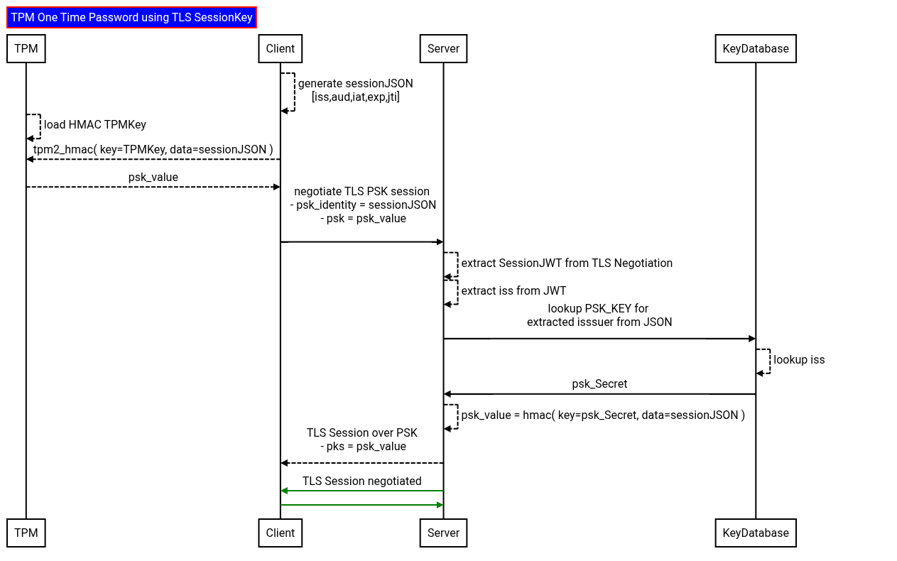
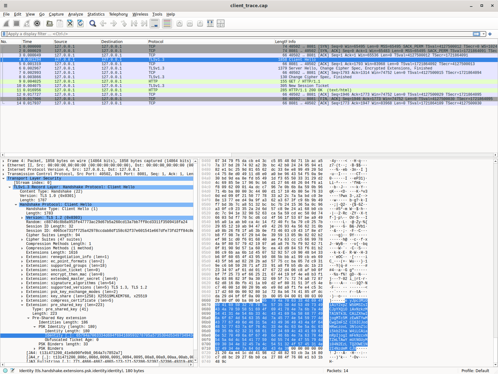
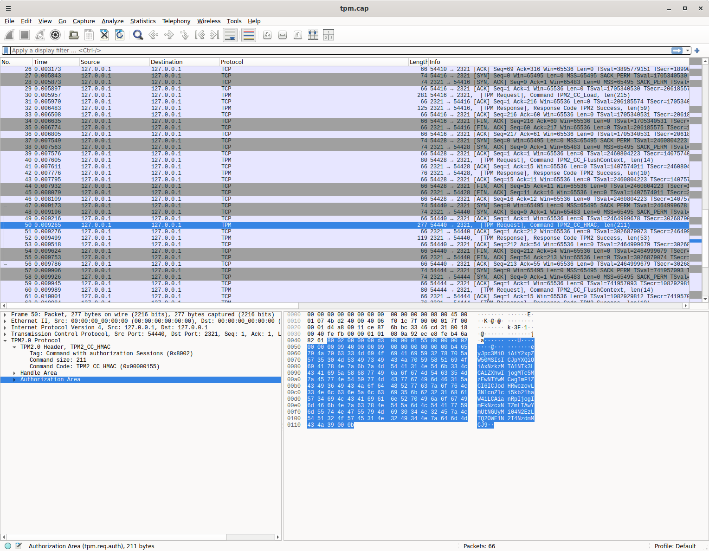

### TLS PSK key derivation using Trusted Platform Module

Generates a per-connection [TLS-PSK](https://en.wikipedia.org/wiki/TLS-PSK) using `TPM` bound keys.

This esseintially provides `External PSKs (Out-of-Band)` which is derived using an HMAC key ebedded on the client's TPM Hardware.

Imagine an remote device where you'd like to use a TPM as a basis for TLS.  Normally, you can setup mTLS using TPM based keys and that requires x509 key distribution and an PKI system.

As an alternative, this repo describes a way to get TLS using a pre-shared key.  Its understood that both the client and server would need access to the same key so yeah, there is still that form of key distribution.

However, if you do want plain PSK-based TLS where the remote system may not want to deal with RSA|ECC signatures, this repo is for you.

This is just a sample i put together for no particular reason;  its not supported by Google


the full flow is something like this



1. Client and server have the same HMAC key

   Client's key will be on its `TPM` 

   Servers key can be in a secure database it controls

2. Client generates a JSON message which includes

   - nonce (`jti`):  this is a unique random identifier to avoid replay
   - issuer (`iss`): this is essentially the PSK client identifier and is used to find the key on the server
   - audience (`aud`): this indicates the server this request is for

```json
{
  "iss": "client1",
  "iat": 1793105597,
  "exp": 1793105600,
  "aud": "https://server.domain",
  "jti": "ad77156f-00be-4e22-87a3-469a57b877f0"
}
```

3. Client creates an hmac using the JSON message

   `psk_key = tpm2_hmac( key=tpm_key, message=json_message )`

4. Client initiates TLS PSK session

   set the `PSK Identity` as the JSON message

   set actual `PSK` to use as `psk_key`

   Note the TLS message here is over cleartext; its just setting up the session

5. Server reads the `PSK Identity` which is the `json_message`

   Server parses the JSON message and extracts the `iss` field

   Server can validate other fields here (`aud`, `jti`, `iat`, `exp`)

6. Server looksup the HMAC key in the database for the `iss`

7. Server runs hmac using the recalled key and the json message

   `psk_key = hmac( key=tpm_key, message=json_message )`

8. Server responds back to the TLS PSK session using the derived `psk_key`

9. TLS Session established since both ends use the same PSK as the basis for the session


Also note that in step 2, the client identity is just an encoded JSON message.  If you want, you can protect it by issuing an HMAC signed JWT (`HS256`) too using the TPM embedded key

---

Also see

- [mTLS with TPM bound private key](https://github.com/salrashid123/go_tpm_https_embed)
- [Multiparty Consent Based Networks (MCBN)](https://github.com/salrashid123/mcbn)
- [TPM One Time Password using TLS SessionKey](https://github.com/salrashid123/tls_tpm_one_time_password)
- [tpmcopy: Transfer RSA|ECC|AES|HMAC key to a remote Trusted Platform Module (TPM)](https://github.com/salrashid123/tpmcopy)
- [tpm2genkey: create keys on TPM](https://github.com/salrashid123/tpm2genkey)

Finally, while it is similar to using the client and server randoms to derive a PSK described in [Per-Session TLS1.2-PSK using Trusted Platform Module (TPM)](https://github.com/salrashid123/tls_psk_tpm).  This specific variation does not depend on `TLS1.2` and can work in `TLS1.3`


---

#### Setup TPM

The following demo uses a [swtpm](https://github.com/stefanberger/swtpm) since its a demo.

It also uses [tpm2_tools](https://github.com/tpm2-software/tpm2-tools) to generate the HMAC key

So, start the swtpm and create an HMAC key.

You can either use the swtpm built into this repo, or uncomment the sections below to create your own from scratch

```bash
cd client/
#rm -rf myvtpm && mkdir myvtpm && swtpm_setup --tpmstate myvtpm --tpm2 --ecc  --create-ek-cert
swtpm socket --tpmstate dir=myvtpm --tpm2 --server type=tcp,port=2321 --ctrl type=tcp,port=2322 --flags not-need-init,startup-clear --log level=5
```

Import the key using `tpm2_tools` but if you just want to use the default swtpm here, *skip this step* entirely

The hex key we're using is `6d795f6170695f6b6579`.  Since this is a demo, we're just going to assume the server knows this value too

```bash
export TPM2TOOLS_TCTI="swtpm:port=2321"
export TPM2OPENSSL_TCTI="swtpm:port=2321"

export secret="my_api_key"
echo -n $secret > hmac.key
hexkey=$(xxd -p -c 256 < hmac.key)
echo $hexkey
#   6d795f6170695f6b6579

printf '\x00\x00' > unique.dat
tpm2_createprimary -C o -G ecc  -g sha256  -c primary.ctx -a "fixedtpm|fixedparent|sensitivedataorigin|userwithauth|noda|restricted|decrypt" -u unique.dat

tpm2 import -C primary.ctx -G hmac -i hmac.key -u hmac.pub -r hmac.priv
tpm2_flushcontext -t && tpm2_flushcontext -s && tpm2_flushcontext -l
tpm2 load -C primary.ctx -u hmac.pub -r hmac.priv -c hmac.ctx
tpm2_encodeobject -C primary.ctx -u hmac.pub -r hmac.priv -o tpm-key.pem
```

Note, you can securely transfer the key from the server to the client using [tpmcopy](https://github.com/salrashid123/tpmcopy)

## Server

Now start the server. Note the server as the psk for this client id alrady

```bash
cd server
pip3 install flask
python3 server.py 
```

## Client

Now start the client after installing the TPM libraries

```bash
apt-get install libtss2-dev
python3 -m pip install tpm2-pytss
# python3 -m pip install git+https://github.com/tpm2-software/tpm2-pytss.git
```

The output shows the JSON that is sent as the clientID and the derived PSK value used

```bash
$ python3 client.py 

Identity: eyJpc3MiOiAiY2xpZW50MSIsICJpYXQiOiAxNzkzMTA1NTk3LCAiZXhwIjogMTc5MzEwNTYwMCwgImF1ZCI6ICJodHRwczovL3NlcnZlci5kb21haW4iLCAianRpIjogImFkNzcxNTZmLTAwYmUtNGUyMi04N2EzLTQ2OWE1N2I4NzdmMCJ9
PSK: 5b120955c62a1d59a819b8c97be4fdbf393099d97de65cc1cc3d97071c1c493a
ok
```

The server shows the same JSON and the same PSK it derived by looking up the `iss` in the database

```bash
$ python3 server.py 

eyJpc3MiOiAiY2xpZW50MSIsICJpYXQiOiAxNzkzMTA1NTk3LCAiZXhwIjogMTc5MzEwNTYwMCwgImF1ZCI6ICJodHRwczovL3NlcnZlci5kb21haW4iLCAianRpIjogImFkNzcxNTZmLTAwYmUtNGUyMi04N2EzLTQ2OWE1N2I4NzdmMCJ9
{'iss': 'client1', 'iat': 1793105597, 'exp': 1793105600, 'aud': 'https://server.domain', 'jti': 'ad77156f-00be-4e22-87a3-469a57b877f0'}
client1
PSK: 5b120955c62a1d59a819b8c97be4fdbf393099d97de65cc1cc3d97071c1c493a
127.0.0.1 - - [27/Oct/2026 08:53:17] "GET / HTTP/1.1" 200 -
```

### dTLS

This repo also shows a similar flow in golang using dTLS...however for the proof of concept here, use the python version.


### Trace

If for whatever reason you wanted to see a trace on the wire for the TPM and TLS and had nothing better to do:


```bash
cd trace/
sudo tcpdump -s0 -ilo -w tpm.cap port 2321

sudo tcpdump -s0 -ilo -w client_trace.cap port 8081
wireshark client_trace.cap -otls.keylog_file:client_keylog.log

wireshark tpm.cap

```

for the SSL PSK:




for the actual TPM HMAC operation:


